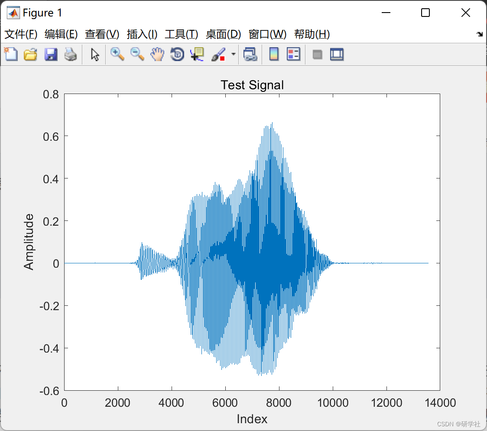
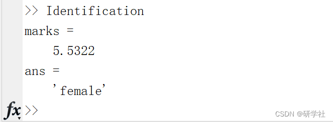
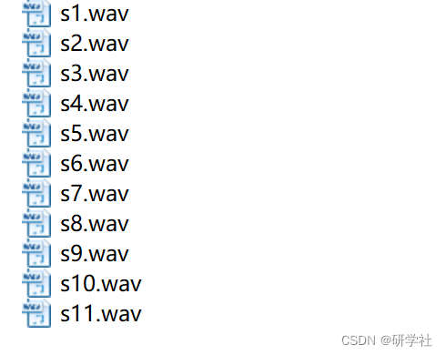

# Implementation of gender recognition based on voice signal (Matlab code)

​  
💥💥💞💞 Welcome to this blog❤️❤️ 💥💥 🏆 Bloggers' Advantages: 🌞🌞🌞 The content of the blog strives for rigorous thinking and clear logic to facilitate readers. ⛳️ Mantra: "Those who travel a hundred miles may have completed only half their journey." Table of Contents 📝 1. Overview 📝 2. Run Results 📃 3. References 📋 4. MATLAB Code Implementation 📋 1. Overview Gender Identification aims to analyze and process input speech signals to determine the gender of the speaker in a speech processing system, which is an important research topic in speaker recognition and speech recognition. Accurate gender identification is not only significant for improving the accuracy of speaker recognition but also can significantly enhance the accuracy of speech recognition by adding gender identification at the front end of non-specific person continuous speech recognition, followed by using male and female voice models to perform speech recognition on the input speech.
📝2 Running Results Edit
Editor
Editor
Part of the code:
%% Digital Signal Processing Project- Gender Identification and Classification  
%% Program:  
%Feature Matrix  
datamat=zeros(11,4); % data matrix to store features  
for k=1:11  
filename=['s' num2str(k) '.wav'];  
[my2,fs] = audioread(filename);%Reading the files  
[fundamental_freq,zero_crossing,short_energy]=Charac_features(my2,fs);%Finding features  
%Storing features in the data matrix  
datamat(k,1)=k;  
datamat(k,2)=fundamental_freq;  
datamat(k,3)=zero_crossing;  
datamat(k,4)=short_energy;  
end  
%% Feature Extraction and Classification  
fundamental_freq_level=135;%Manually fixing the value of the fundamental freq  
zero_crossing_level=12;%Manually fixing the value of the zero crossing value  
short_energy_level=0.5;%Manually fixing the value of the Short energy value  
%Reading a file and getting the fundamental,zero crossing, short energy  
%values  
[my2,fs] = audioread('s2.wav');  
figure;plot(my2);title('Test Signal');  
xlabel('Index');ylabel('Amplitude');  
[freq,zero_cross,short_ene]=Charac_features(my2,fs);  
% Giving weights and finding a number for a particular observation
marks = 0.25 * (freq / fundamental_freq_level) + (zero_cross / zero_crossing_level) * 0.35;
marks = marks + (0.4 * short_ene / short_energy_level);
if marks > 1 % If the value is greater than 1 for that particular observation
    ans = 'female'
else
    ans = 'Male'
end

%%

📃3 References [1] Huang Guanwei. A Mixed Algorithm for Speaker Gender Identification [J]. Modern Computer (Professional Edition), 2008(08):8-11+17.

📋4 Matlab Code Implementation

## Images

<!-- PAYMENT_BLOCK -->

## Get this dataset

- Payment link (Stripe): [Buy now](https://buy.stripe.com/3cs8yP7sY87d0vu9AB)
- Payment QR code: 

<!-- /PAYMENT_BLOCK -->
